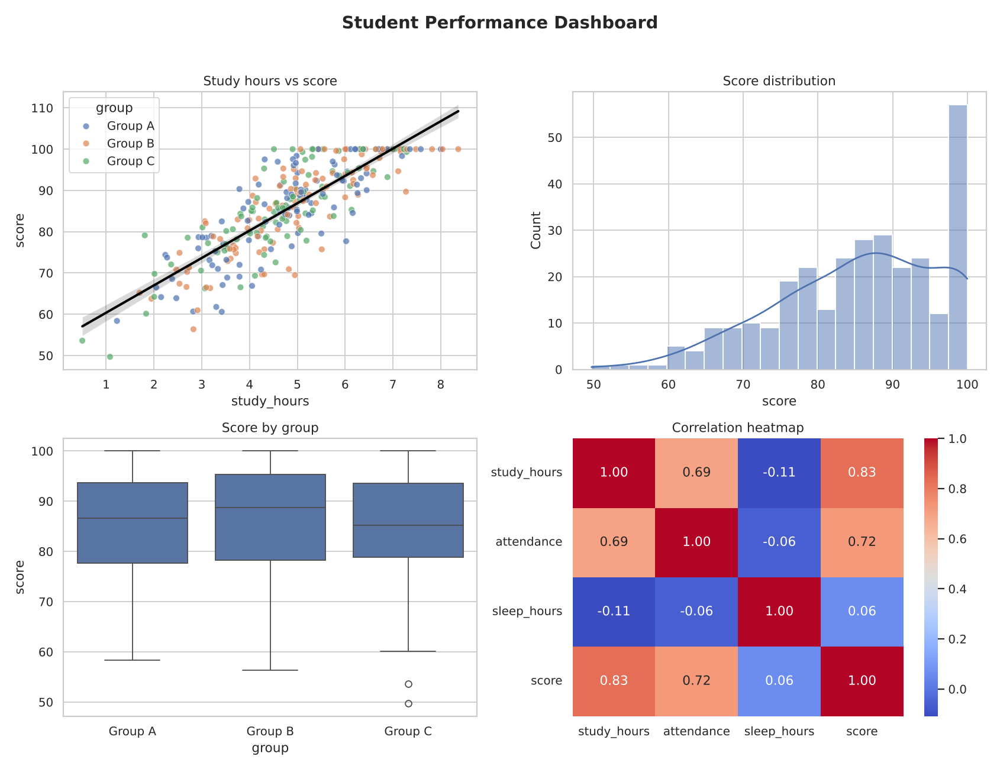

# SkyBrisk Python for Data Analytics Internship

Weekly tasks completed by **Meenakshi A** during the SkyBrisk Data Analytics internship. Each week folder holds the Python script and a concept summary.

| Week | Topic | Client project | Folder |
|------|-------|----------------|--------|
| 1 | Intro to Python | Average temperature report | [week1](week1) |
| 2 | Data structures and functions | Data cleaning script | [week2](week2) |
| 3 | NumPy and Pandas | Clean and aggregate a dataset | [week3](week3) |
| 4 | Matplotlib and Seaborn | Feature-relationship dashboard | [week4](week4) |

## Run locally
```bash
pip install -r requirements.txt
python week1/week1_intro_python.py
python week2/week2_data_structures_functions.py
python week3/week3_numpy_pandas.py
python week4/week4_visualization_dashboard.py
```
The scripts generate their own sample data, so no external files are needed. Week 3 and 4 outputs (`cleaned_sales.csv`, PNG charts) are saved in the folder you run them from.

## Dashboard preview


## Skills demonstrated
Python fundamentals, data structures, data cleaning, NumPy, Pandas, Matplotlib, Seaborn.
